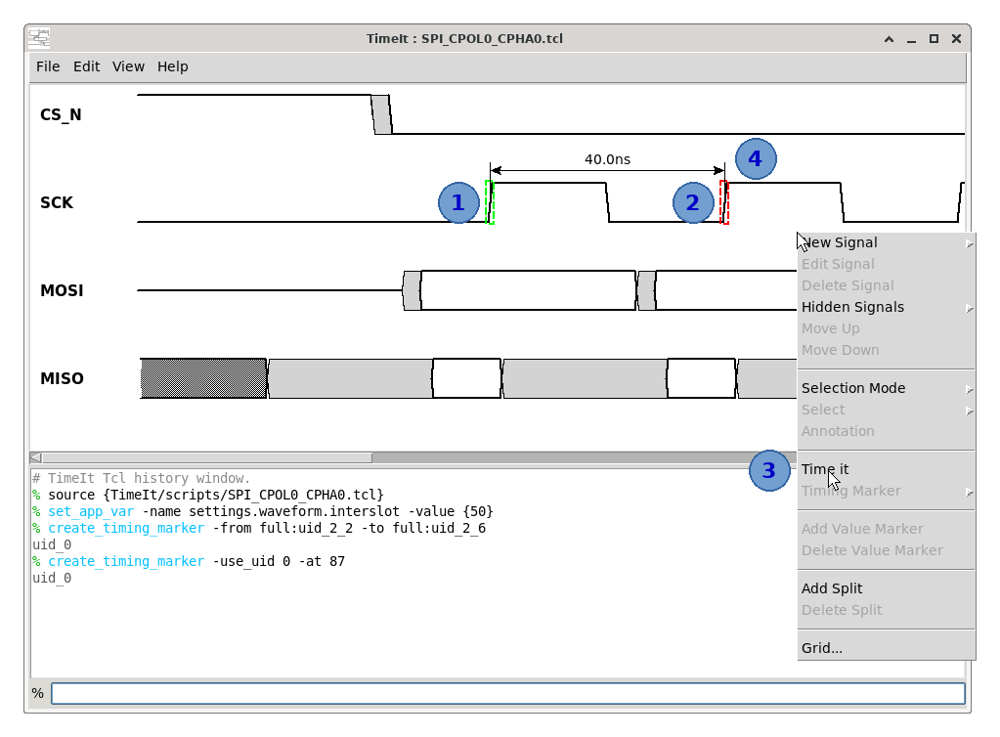
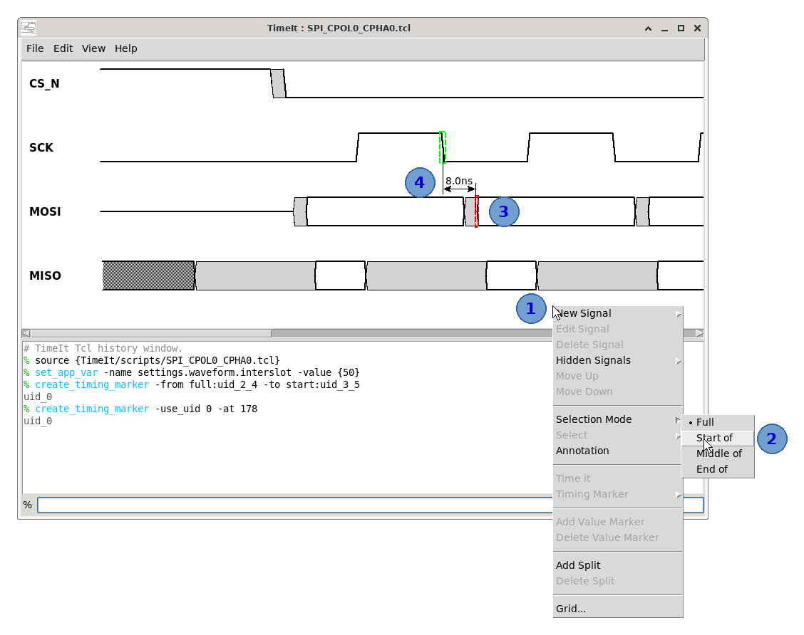
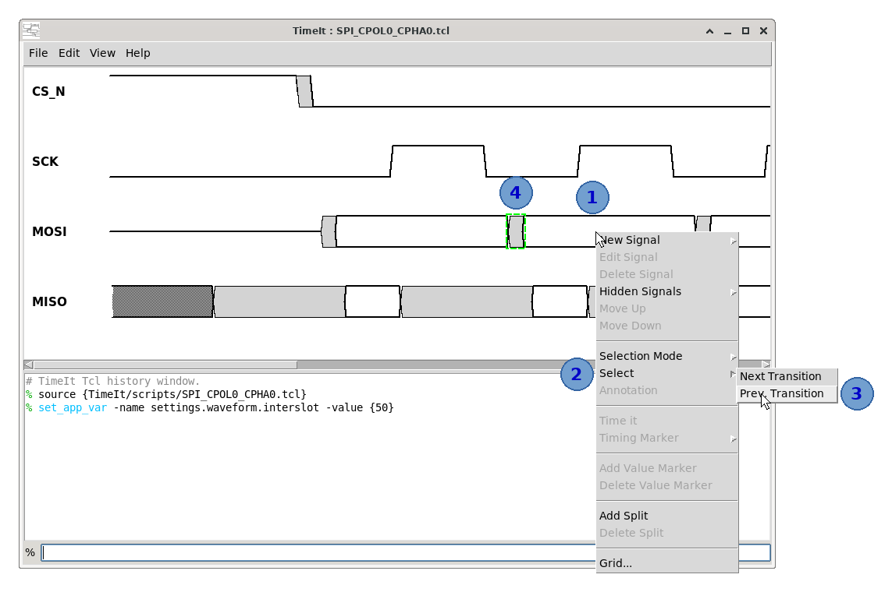
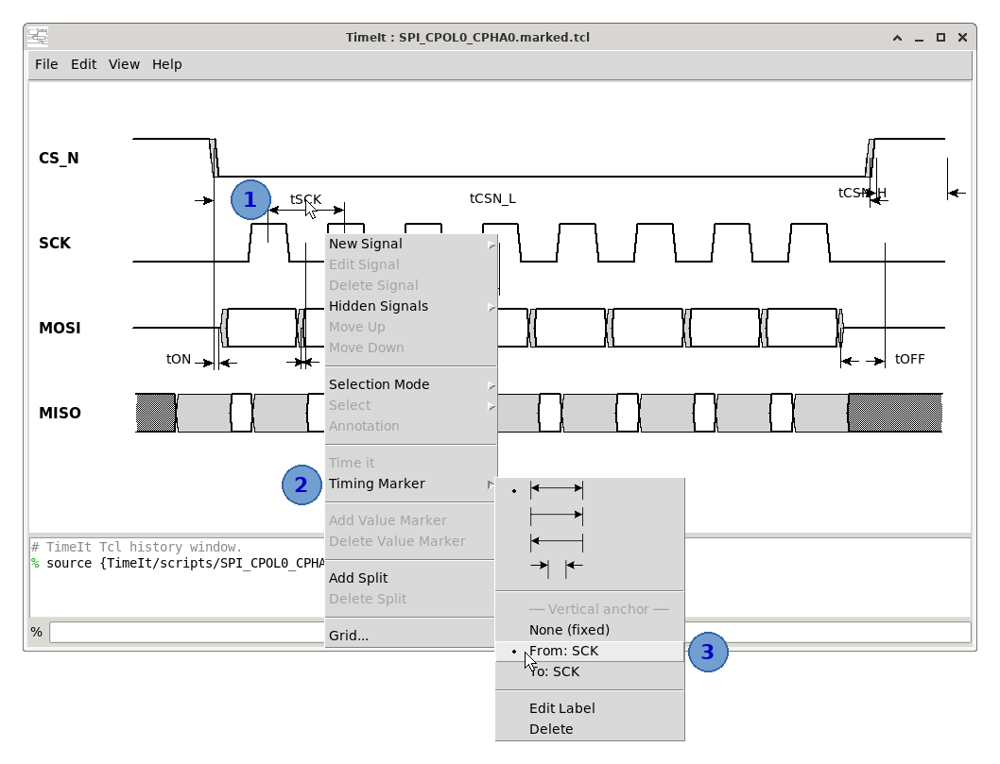
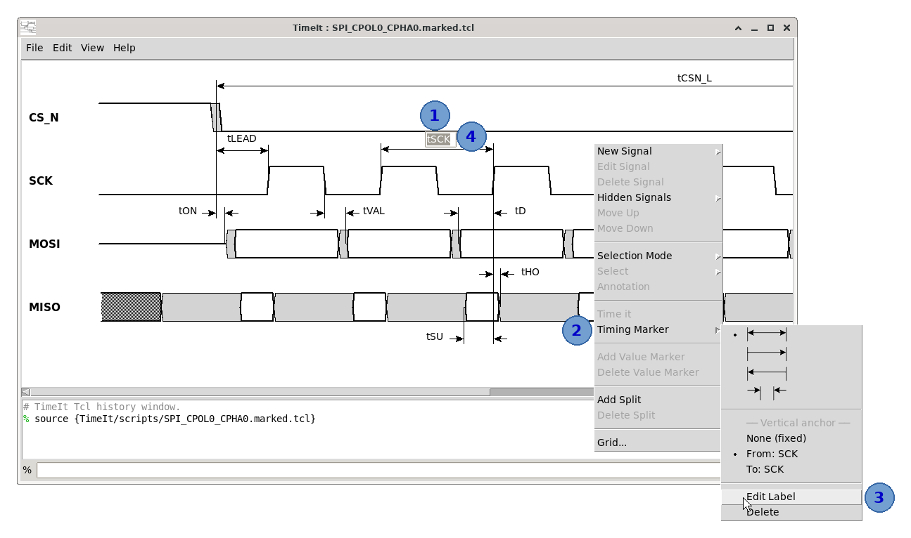
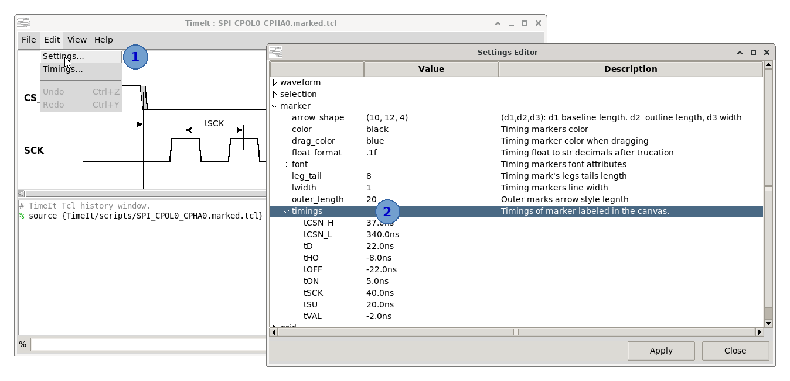
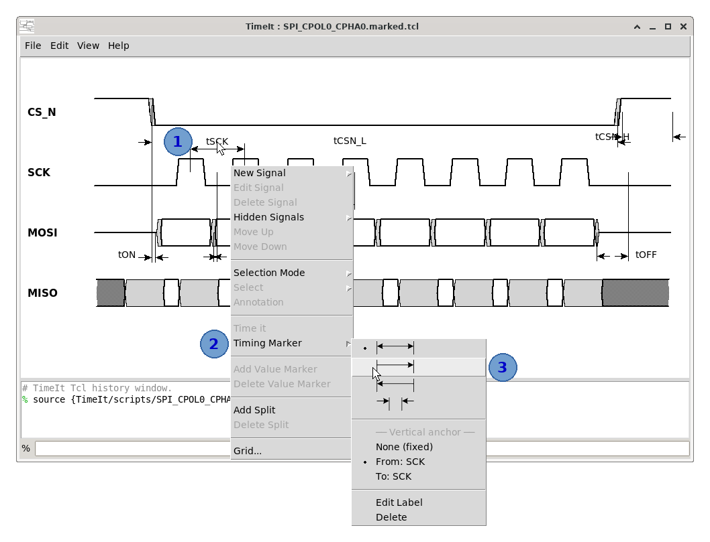
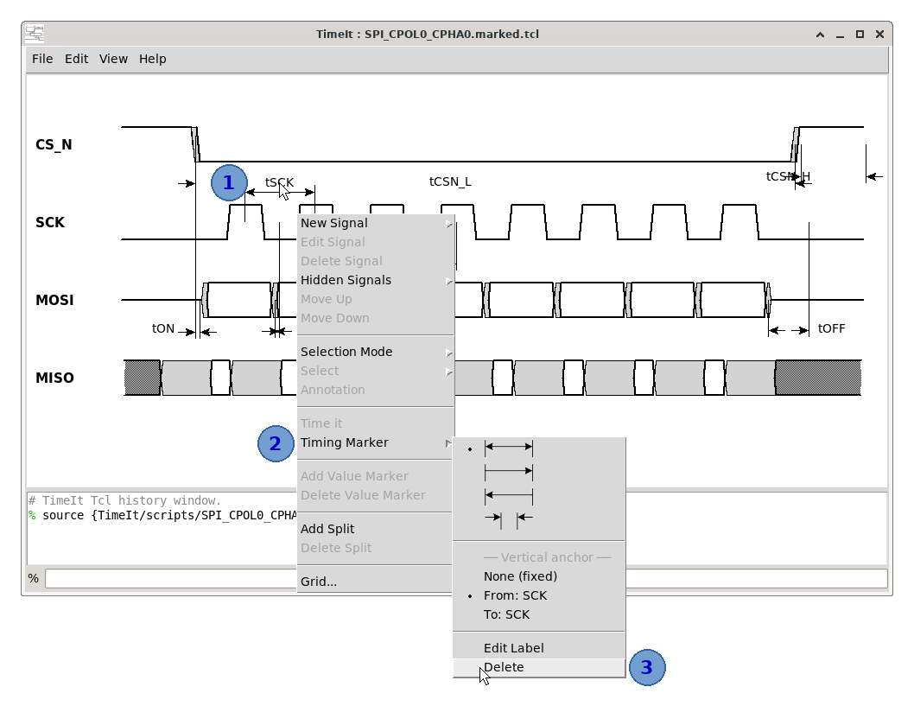
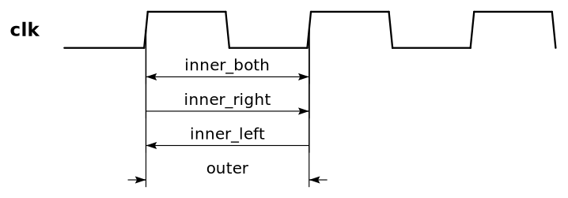

# How to create timing markers

Timing markers draw a measured arrow between two waveform points, annotating the time interval between them. Timing markers are usually created in the GUI. The associated command is `create_timing_marker` in the TCL console.

## GUI procedure

The pictures of this page use the SPI example `scripts/SPI_CPOL0_CPHA0.tcl`, zoomed in on its first bits. Load it (**File→Load Script…**) to follow along.

A marker is drawn between two waveforms, so it needs some room there. Here the space between the signals was first increased, with the command shown in the console pane of the pictures:

```tcl
set_app_var -name settings.waveform.interslot -value {50}
```

(or **Edit→Settings…**, group **waveform**, see [How to lay out signals in the canvas](14_layout.md)).

The first marker measures one SCK period, from a rising edge to the next one:



1. Select the marker's start-point. <kbd>Mouse Left-click</kbd> on the waveform transition (or shape) of interest. A green bounding-box (bbox) showing the selection will appear. Beware that other waveform shapes may be located at the same selection point. If the shape bbox is not the one desired, click again and the selection will shift to the next object in the area (rotating selection). 
2. Select the marker's end-point (by holding  <kbd>Ctrl</kbd> key down). <kbd>Ctrl-Mouse Left-click</kbd> on the waveform transition (or shape) of interest. A red bounding-box (bbox) showing the selection will appear. If the shape bbox selection is not the one desired, click again (holding <kbd>Ctrl</kbd> key down) and the selection will shift to the next object.   
3. Once start-point and end-point are selected, <kbd>Mouse Right-click</kbd> anywhere in the canvas to make the contextual menu appear and select "**Time it**". The timing marker will be created and its label will indicate the time value in between start and end points.  
4. To move the timing marker vertically, hover over one of its arrow tips, not the label. When the pointer icon changes, click and drag the marker to its new position. In the picture it was dragged up, into the free space above SCK.
5. (not shown in figure above). The timing marker label can also be moved. Hover over the label, when the mouse pointer icon changes, click and drag the label to a different location.

Everything done with the mouse is logged in the console pane as the equivalent command: the creation of the marker, then its move (`create_timing_marker -use_uid 0 -at ...`).

----
### Marker selection mode
A click selects a whole waveform shape, and the marker is then measured from or to its middle. That is right for a clock edge, but not for a data window, where the point of interest is its beginning or its end. The selection mode says which point of the shape is meant, and it must be set **before** clicking the shape.

Example: the delay from a falling SCK edge to the **start of** the MOSI data window it launches (8 ns in the SPI example). The selection mode is set to "**Start of**" before the end-point is selected:

 

1. **After** having selected the clock edge first and **before** selecting the end-point. <kbd>Mouse Right-click</kbd> anywhere in the canvas to get the contextual menu.
2. Select "**Start of**" in the **Selection Mode** cascade menu.
3. Then, holding <kbd>Ctrl</kbd> key down, click on the waveform point of interest to select only the "*start of*" part. (The data valid in this example: a thin red box marks its start.)
4. <kbd>Mouse Right-click</kbd> anywhere in the canvas to make the contextual menu appear and select "**Time it**". The marker is created; in the picture it was then dragged between SCK and MOSI.

The selection mode stays as set: remember to put it back to "**Full**" before selecting a clock edge again.

----
### Quick selection of transitions
Clicking precisely on a transition is not always easy: the shapes drawn for a signal overlap, and a click may land on the neighbouring shape (the rotating selection then takes a few more clicks). Since the points of interest are nearly always **signal transitions** (a clock edge, a data change, an edge of a logic signal...), the contextual menu offers a way to select them without aiming:



1. Place the mouse pointer over the signal strip (slot) of interest, to the left or to the right of the transition you want, and <kbd>Mouse Right-click</kbd>. The pointer does not need to be on a drawn shape: anywhere in the strip will do.
2. Open the "**Select**" cascade menu (just below **Selection Mode**).
3. Choose "**Next Transition**" to select the closest transition on the right of the pointer, or "**Prev. Transition**" for the closest one on its left (as in the picture, where the pointer is on the right of the MOSI transition wanted).
4. The selection bbox appears exactly as after a click.

The rules of the click selection apply:

- Without <kbd>Ctrl</kbd> the previous selection is replaced (the new point becomes the start-point, in green). Hold <kbd>Ctrl</kbd> **while right-clicking** to add the point to the selection (an end-point, in red). Selecting again a point already selected removes it from the selection.
- The **Selection Mode** applies, and it also decides where a transition is located: in "**End of**" mode, for instance, the next transition is the first one *ending* on the right of the pointer, which lets you pick the end of the transition window the pointer is in.
- Every change of the signal counts as a transition: clock edges, data/unknown/high-Z windows, high and low transitions, pull-up rises and the transitions of logic and sampled signals. A transition within the click tolerance of the pointer is both the next and the previous one. The entries are greyed out when there is no transition on that side, when the pointer is not over a signal strip, or over a PWL (analog) strip, which has no transitions.

Once the start-point and the end-point are selected this way (or mixed with clicks), "**Time it**" creates the marker as usual.

----
### Marker relative position
By default, a timing marker has an absolute position on the canvas. If the waveforms move, the marker stays in place and may overlap other waveforms or annotations. To prevent this, the marker can be anchored to either the start-point or end-point waveform, so it moves together with the selected waveform.

The pictures of the rest of this page use `scripts/SPI_CPOL0_CPHA0.marked.tcl`, the same SPI example with its timing markers. The marker worked on is `tSCK`.

 

1. <kbd>Mouse Right-click</kbd> over the timing marker.
2. Select "**Timing Marker**" cascade menu.
3. Select within the *--Vertical anchor--* menu section the signal name the marker shall be relative to: the signal of its start-point (**From:**) or of its end-point (**To:**). `tSCK` starts and ends on SCK, so both entries name it.

----

### Renaming timing label
When first created the timing marker label shows the timing value number in between the start and end point. User can edit the label and provide a symbolic text.



1. <kbd>Mouse Right-click</kbd> over the timing marker label.
2. Select "**Timing Marker**" cascade menu.
3. Click on "**Edit Label**" menu entry
4. The label is now editable.

To get the timing values associated with the edited timing marker labels: from the menu bar select **Edit→Settings...** (1) and expand **marker → timings** (2). Each named marker gives its measured value there.



----
### Changing timing marker arrow style



1. <kbd>Mouse Right-click</kbd> over the timing marker label.
2. Select "**Timing Marker**" cascade menu.
3. Select the marker (arrow) style: one of the four drawings at the top of the menu. The current style has a dot.

The four styles are pictured in [Marker styles](#marker-styles) below. Use the *outer* style when the two points are too close for the arrows and the label to fit between them.

----
### Delete timing marker



1. <kbd>Mouse Right-click</kbd> over the timing marker label.
2. Select "**Timing Marker**" cascade menu.
3. Select "**Delete**"


## Command syntax

```
create_timing_marker  -name name
                      -from select:uid
                      -to select:uid
                      [-at y_coord]
                      [-style (inner_both)|inner_right|inner_left|outer]
                      [-anchor (none)|from|to]
                      [-label_x rel_x]
                      [-label_y rel_y]
                      [-use_uid marker_uid]
                      [-help]
```

## Key parameters

| Parameter | Description |
|---|---|
| `-name` | Marker label. Use `""` to display the measured time value directly; a non-empty name stores the value and displays the name instead. |
| `-from` | Start measurement point as `select:uid` (e.g. `end:uid_1_3`). |
| `-to` | End measurement point as `select:uid`. |
| `-at` | Y position of the marker line on the canvas (pixels). |
| `-style` | Arrow style (see below). Default: `inner_both`. |
| `-anchor` | `none` (absolute y), `from`, or `to` (y relative to the anchored signal slot). |
| `-label_x` | Horizontal offset of the label from the marker midpoint (px). |
| `-label_y` | Vertical offset of the label from the marker line (px). |
| `-use_uid` | The uid of the **marker itself** (not of a waveform element). Updates that marker instead of creating a new one — see below. |

## Modifying an existing marker

Giving `-use_uid` with the uid of an existing marker **updates it in place** instead of creating a second one. Only the options given are applied; the others keep their current value, and `-from` / `-to` are not needed, since what a marker measures is fixed when it is created:

```tcl
# Example:
create_timing_marker -use_uid 0 -style outer          ;# restyle it
create_timing_marker -use_uid 0 -anchor from -at 30   ;# re-anchor and move it
create_timing_marker -use_uid 0 -name {tSU}           ;# rename its label
create_timing_marker -use_uid 0 -label_x 5 -label_y -8
```

This is what the GUI issues when you restyle, re-anchor, rename or drag a marker, so those actions appear in the console log as commands.

## Removing a marker

A marker is removed by its uid:

```tcl
# Example:
remove -tmarker {0}
remove -tmarker {0 1}
```

A marker is also removed together with the signal it measures (`remove -signal`).

## Measurement point syntax: `select:uid`

The `select` part specifies which point on the waveform element to measure:

| Selector | Meaning |
|---|---|
| `full` | Mid-point of the full element bounding box |
| `start` | Left edge of the element bounding box |
| `end` | Right edge of the element bounding box |
| `middle` | Horizontal centre of the element bounding box |

`uid` is the unique tag of a waveform element (e.g. `uid_1_3`). UIDs are shown when you click on a waveform element in the canvas.

## Marker styles

| Style | Description |
|---|---|
| `inner_both` | Arrow line between the two legs, arrows on both ends (default) |
| `inner_right` | Arrow on right end only |
| `inner_left` | Arrow on left end only |
| `outer` | Two outward arrows pointing at the measurement points |

The four styles, on a marker measuring one clock period (each label is the name of the style):



## Step-by-step example

### 1. Display the measured time as the label

```tcl
create_timing_marker -name "" \
                     -from end:uid_1_2 \
                     -to start:uid_2_1 \
                     -at 80
```


### 2. Named marker (value stored for later use)

```tcl
create_timing_marker -name "tsu" \
                     -from end:uid_1_2 \
                     -to start:uid_2_1 \
                     -at 80 \
                     -anchor from \
                     -style inner_both
```

The value is stored in the timings dictionary and is accessible as `$tsu` in subsequent TCL expressions.


## How to find UIDs

Click on a waveform element in the canvas. The status bar (or console) will report the UID of the element under the cursor.

> ⚠️ **Warning:** Status bar messages and *get_...* facility commands are not implemented yet.

---

*Previous: [How to create input/output signal(s)](04_io_signals.md) | Next: [How to save and load](06_save_load.md)*
