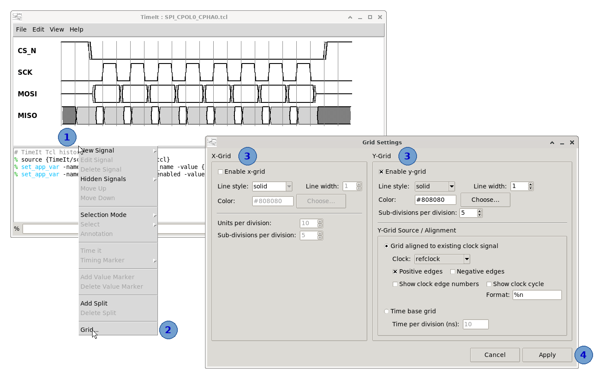
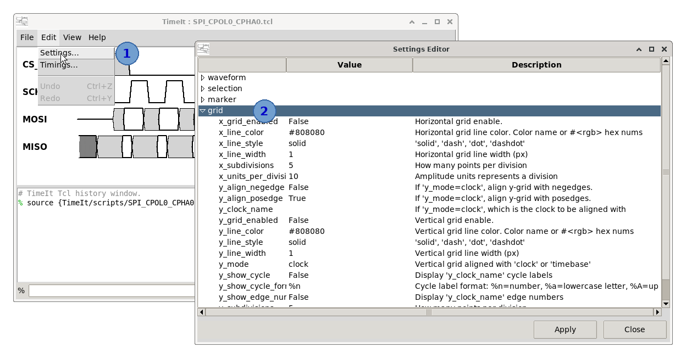

# How to show the background grid

The background grid helps align timing markers and visually read signal timing relationships. There are two grids:

- the **y-grid** draws vertical lines, either on the edges of a clock of the diagram or every so many time units. It is the one that helps reading timings: each line marks an instant on every waveform.
- the **x-grid** draws horizontal lines across the waveforms.

## Enabling the grid

### Via the contextual menu
 

 
1. <kbd>Right-click</kbd> anywhere in the canvas to get the context menu.
2. Select **Grid...**: the *Grid Settings* dialog appears.
3. Enable the x-grid and/or the y-grid and set their options at your convenience. The y-grid can follow the edges of a clock of the diagram (**Grid aligned to existing clock signal**: select the clock and its edges, and check **Show clock edge numbers** to print `1P`, `2P`... above the lines), or a fixed time base (**Time base grid**).
4. Click **Apply**.

In the picture the y-grid follows the rising edges of `refclock`, the clock every signal of the SPI example is timed by. That clock is hidden, but the grid can still follow it: every SCK edge and every data change falls on a line.

The same dialog opens from the menu bar: **View → Grid…**


### Via the TCL console

Grid options can be set by using a variables family group `settings.grid.*` :

```tcl
# The y-grid of the picture above: on the rising edges of refclock
set_app_var -name settings.grid.y_clock_name -value {refclock}
set_app_var -name settings.grid.y_grid_enabled -value {True}

# Print the clock edge numbers above the lines
set_app_var -name settings.grid.y_show_edge_numbers -value {True}

# The x-grid
set_app_var -name settings.grid.x_grid_enabled -value {True}
```

The edge numbers are printed above the first waveform: give it some room with `settings.waveform.top_padding` (see [How to lay out signals in the canvas](14_layout.md)). The examples of [How to create input / output signal(s)](04_io_signals.md) show a numbered grid.
To know the full set of grid setting variables, open the *Settings Editor* with **Edit → Settings…** (1) and expand the "**grid**" group (2).




---

*Previous: [How to save and load](06_save_load.md) | Next: [How to export the canvas](08_export.md)*
