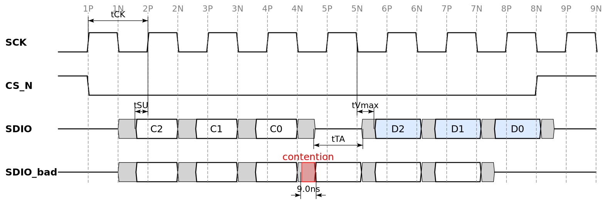
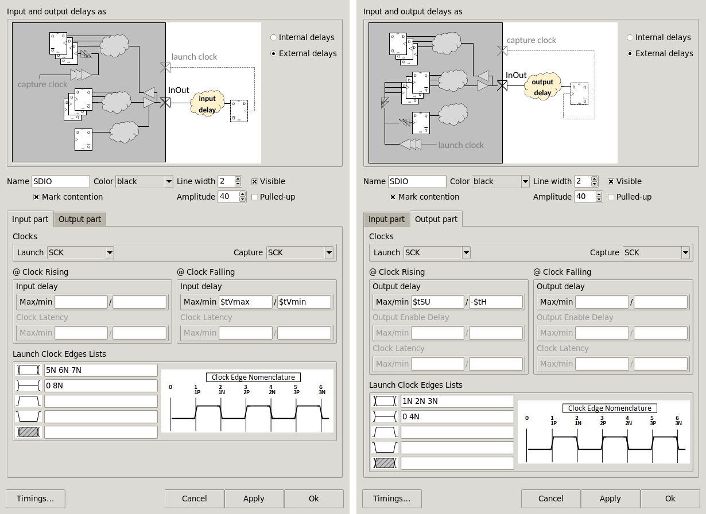

# How to create bidirectional (inout) signal(s)

A bidirectional signal is a **device port** that is driven from outside at some times and by the device at others: a data bus shared by a read and a write access, a single data line carrying a command one way and its answer the other way, an open-drain line... It is created with `create_inout`, and called a **Bidir** signal in the GUI.

Bidirectional is meant from the port point of view. Inside the device there is nothing bidirectional: a receiving path and a driving path meet at the pad. This is exactly how the signal is described, and why it is, in one command, a `create_input` and a `create_output`:

- an **input part**: the port driven from outside and captured by the device,
- an **output part**: the port driven by the device and captured outside.

Each part has its own launch/capture clocks, its own delays and its own launch edge lists, and both are drawn in the **same waveform slot**. Everything said about input and output signals in [How to create input / output signal(s)](04_io_signals.md) holds for the corresponding part: launch and capture clocks, which edge the delays refer to, edge list notation.



---

## What belongs to the port, what belongs to a part

| Given once, for the port | Given for each part |
|---|---|
| Name, color, line width, amplitude, visibility | Launch clock and capture clock |
| **Delay specification**: `internal` or `external` | Delays at the rising / falling clock edge |
| Pull-up | Clock latencies (internal delays only) |
| Whether contention zones are marked | Output enable delays (output part, internal delays only) |
| | Launch edge lists (data, Hi-Z, high, low, unknown) |

**One delay specification for both parts.** A port is specified either with the delays of your own flip-flops (`internal`) or with the delays of the device at the other end (`external`). It is not possible to choose one for the input part and the other for the output part:

| | `-specify internal` | `-specify external` |
|---|---|---|
| **Input part** (`-rclk/fclk_inputdly_...`) | Setup/hold of your capturing flip-flops, counted backwards from the **capturing** edge | Clock-to-output of the driving device, counted forward from the **launching** edge |
| **Output part** (`-rclk/fclk_outputdly_...`) | Clock-to-output of your launching flip-flops, counted forward from the **launching** edge | Setup/hold of the receiving device, counted backwards from the **capturing** edge |

**All the clocks are related.** The launch and capture clocks of a part must be related, as for any I/O signal, and so must the clocks of the input part and of the output part: the four of them share the same source clock. They may all be the same clock.

---

## Hi-Z: a part that does not drive must say so

The two parts are drawn as an input signal and an output signal would be, on top of each other. What keeps the result readable is the Hi-Z state:

- While the port **receives**, the **output part must be Hi-Z** (`-out_hiz_edges`).
- While the device **drives**, the **input part must be Hi-Z** (`-in_hiz_edges`).

A part that is Hi-Z has released the port. Its Hi-Z line is therefore **only drawn where the other part does not drive either**: where both are Hi-Z (a turnaround, an idle bus) the port shows a single Hi-Z line, and where one drives, only what it drives is shown.

A typical definition therefore starts both parts Hi-Z at edge `0`, and returns each of them to Hi-Z after its last word:

```tcl
   -out_hiz_edges {0 4N}  -out_data_edges {1N 2N 3N}     ;# the device sends, then releases
   -in_hiz_edges  {0 8N}  -in_data_edges  {5N 6N 7N}     ;# the other end answers, then releases
```

The edge lists of a part name edges of **its own launch clock**.

## Port contention

Where **both parts may drive the port at the same time** there is a contention. A part drives in every state but Hi-Z, *transition windows included*: a part releasing the port may still drive it until the end of its release window, and a part taking the port may already drive it from the beginning of its window. A release that may end after the other side may already drive is a contention, which is what a bus turnaround time is there to avoid.

- The zones are **marked in red** on the waveform. A zone is a waveform element like any other: it can be selected, measured with a timing marker and annotated.
- A **warning** lists them, in the console when the signal is drawn (once, until they change) and in a message box when the dialog is applied.

It is only a warning. The signal is created as given: showing a contention may be the very purpose of the diagram. If the zones are not wanted on the picture, uncheck **Mark contention** (`-hide_contention`); the warning is still given.

With a **pull-up** (`-pulled_up`) the port is an open-drain line: both parts pulling it low at the same time is not a contention.

A handover made on the very same instant by both sides (a zero-length overlap) is not reported. Note that with capture-side delays (input part with internal delays, output part with external delays) a change is only *established* at its setup bound, close to the capturing edge: releasing the port and letting the other side drive it from the same clock edge usually shows a contention, as it would on a real bus.

Clutter is not reported: two parts that both draw something in the same place (despite the warning) are drawn as given, and it is up to you to review the definition.

An open-drain line handed over from one side to the other *while low* (an I2C acknowledge after a `0` bit) shows the release of one part, the pull-up rise, and the pull-down of the other within its transition window. This is the possible glitch: if the line may be released before the other side surely pulls it low, it may briefly come up. The rise stops where the other side surely holds the line (the end of its transition window), and is not drawn at all when the other side already holds it before the release. When the release is late enough, the line simply stays low, which the transition window covers.

---

## GUI procedure



1. <kbd>Mouse Right-click</kbd> in the canvas area. Select **New Signal→Bidir...**
2. In the **Signal** frame, give the name and the appearance of the signal. Check **Pulled-up** for an open-drain line.
3. Select internal or external delays. The choice applies to both parts. The illustration shows the delays of the part whose tab is on show, as they are specified.
4. In the **Input part** tab, select the launch and capture clocks, give the input delays and the launch clock edges lists of what the port receives.
5. In the **Output part** tab, do the same for what the device drives. With internal delays the output enable delays time every change to or from Hi-Z, that is the moment the device releases the port or takes it back.
6. Click **Apply** or **Ok**. If the definition shows a contention, or if a part has no edge at all, a warning says so; the signal is created anyway.

Only the clocks related to the ones already chosen are offered, in both tabs. Choosing a clock of another domain clears the three others.

The **Timings…** button and the right-click menu of the delay entries give access to the timing variables, as in the other signal dialogs.

To edit a bidirectional signal, <kbd>double-click</kbd> its name, or <kbd>Right-click</kbd> it and pick **Edit Signal**.

## Command syntax

```
create_inout  -name inout_name
              [-specify (internal)|external]

              # Input part
              -in_launch_clock launch_clk
              -in_capture_clock capture_clk
              [-rclk_inputdly_max {indly_expr}]     [-rclk_inputdly_min {indly_expr}]
              [-fclk_inputdly_max {indly_expr}]     [-fclk_inputdly_min {indly_expr}]
              [-in_rclk_latency_max {lat_expr}]     [-in_rclk_latency_min {lat_expr}]
              [-in_fclk_latency_max {lat_expr}]     [-in_fclk_latency_min {lat_expr}]
              [-in_data_edges {list_edges}]
              [-in_hiz_edges {list_edges}]
              [-in_high_edges {list_edges}]
              [-in_low_edges {list_edges}]
              [-in_unknown_edges {list_edges}]

              # Output part
              -out_launch_clock launch_clk
              -out_capture_clock capture_clk
              [-rclk_outputdly_max {outdly_expr}]   [-rclk_outputdly_min {outdly_expr}]
              [-fclk_outputdly_max {outdly_expr}]   [-fclk_outputdly_min {outdly_expr}]
              [-rclk_oedly_max {oedly_expr}]        [-rclk_oedly_min {oedly_expr}]
              [-fclk_oedly_max {oedly_expr}]        [-fclk_oedly_min {oedly_expr}]
              [-out_rclk_latency_max {lat_expr}]    [-out_rclk_latency_min {lat_expr}]
              [-out_fclk_latency_max {lat_expr}]    [-out_fclk_latency_min {lat_expr}]
              [-out_data_edges {list_edges}]
              [-out_hiz_edges {list_edges}]
              [-out_high_edges {list_edges}]
              [-out_low_edges {list_edges}]
              [-out_unknown_edges {list_edges}]

              [-pulled_up]
              [-hide_contention]
              [-color (black)|green|red|blue|orange|purple]
              [-amplitude amp_value]
              [-lwidth line_width]
              [-visible]
              [-help]
```

The options of a part are the ones of `create_input` / `create_output`. The delay options name their part by themselves (`-rclk_inputdly_max`, `-rclk_outputdly_max`, `-rclk_oedly_max`); the options both commands share (clocks, clock latencies, edge lists) take an `in_` or an `out_` prefix.

### Key parameters

| Parameter | Description |
|---|---|
| `-name` | **Mandatory.** Signal (port) name (may include bus notation, e.g. `dq<7:0>`). |
| `-specify` | `internal` (default) or `external`, for **both** parts. See the table above. |
| `-in_launch_clock` / `-in_capture_clock` | Clocks of the input part. One of them is **mandatory**; giving only one means the same clock launches and captures. |
| `-out_launch_clock` / `-out_capture_clock` | Clocks of the output part, same rule. The four clocks must be related (same source clock). |
| `-rclk/fclk_inputdly_max/min` | Input delays of the input part, as in `create_input`. |
| `-rclk/fclk_outputdly_max/min` | Output delays of the output part, as in `create_output`. |
| `-rclk/fclk_oedly_max/min` | Output enable delays of the output part: the port released or taken back. Internal specify only. |
| `-in_rclk/fclk_latency_max/min` | Clock latency to the capturing FFs of the input part (internal specify only). |
| `-out_rclk/fclk_latency_max/min` | Clock latency to the launching FFs of the output part (internal specify only). |
| `-in_..._edges` | Launch edge lists of the input part (`data`, `hiz`, `high`, `low`, `unknown`), on its launch clock. |
| `-out_..._edges` | Launch edge lists of the output part, on its launch clock. |
| `-pulled_up` | The port has a pull-up (open-drain line): released, it rises to the high level. |
| `-hide_contention` | Do not mark the contention zones on the waveform. |

Re-running `create_inout` with the same `-name` redefines the signal. `set_attribute` reaches the options of both parts by their option name (e.g. `set_attribute -signal dq -name rclk_oedly_max -value {4}`).

A bidirectional signal can be read by a logic or a sampled signal (see [How to create logic and sampled signals](21_logic_signals.md)): it shows them the state of the part that drives, Hi-Z when none does, and unknown where both do. It can not gate a clock.

---

## Step-by-step example

A 3-wire serial link: the device (the master) sends a 3-bit command on `SDIO`, releases the line, and the slave answers with 3 bits on the same line. The delays are the ones of the slave datasheet, hence `-specify external`: the slave needs the command `tSU` before, and `tH` after, the rising edges of `SCK`, and drives its answer `tVmin` to `tVmax` after the falling edges.

```tcl
set_app_var -name timings.tCK   -value {40}
set_app_var -name timings.tSU   -value {8}
set_app_var -name timings.tH    -value {4}
set_app_var -name timings.tVmin -value {3}
set_app_var -name timings.tVmax -value {12}

create_clock -name SCK -topology source \
             -period {$tCK} -rise_at {$tCK/2} -fall_at {$tCK} \
             -show 9 -visible

create_inout -name SDIO \
             -specify external \
             -in_launch_clock SCK \
             -fclk_inputdly_max {$tVmax} \
             -fclk_inputdly_min {$tVmin} \
             -in_hiz_edges {0 8N} \
             -in_data_edges {5N 6N 7N} \
             -out_launch_clock SCK \
             -rclk_outputdly_max {$tSU} \
             -rclk_outputdly_min {-$tH} \
             -out_hiz_edges {0 4N} \
             -out_data_edges {1N 2N 3N} \
             -visible
```

Both sides launch on the falling edges of `SCK`. The output part gives *rising* clock output delays only: with external delays this tells that the slave captures on rising edges. The device releases the line at `4N` and the slave only drives from `5N`: the clock cycle in between is the turnaround, drawn as the single Hi-Z line of the port.

Moving the answer of the slave one cycle earlier (`-in_data_edges {4N 5N 6N}`, `-in_hiz_edges {0 7N}`) removes the turnaround: the slave may drive `tVmin` after `4N` while the device may hold the line until `tSU` before the next rising edge. The contention zone is marked and reported:

```
[InOutSignal] SDIO_bad: possible port contention, the input and the output part may both drive the port from 163 to 172 ns: a part must be Hi-Z while the other one drives
```

Both cases are in [`scripts/bidir_example.tcl`](../scripts/bidir_example.tcl), with the timing markers and annotations of the picture at the top of this page.

---

## Bidirectional ports in SDC

`write_sdc` constrains a bidirectional port as **both an input and an output**: SDC has no `set_inout_delay`. The input part gives a `set_input_delay` and the output part a `set_output_delay`, both on the port, each computed as for an input or an output signal (see [How to write an SDC constraint file](18_write_sdc.md)):

```tcl
# ==== Inout SDIO : bidirectional port, constrained as an input and as an output ====

# ---- Inout input part SDIO : specify external, launch SCK -> capture SCK ----
set_input_delay -clock {SCK} -clock_fall -max [expr {$tVmax}] -min [expr {$tVmin}] [get_ports {SDIO}]
#   (resolves to -max 12 -min 3)

# ---- Inout output part SDIO : specify external, launch SCK -> capture SCK ----
set_output_delay -clock {SCK} -max [expr {$tSU}] -min [expr {-$tH}] [get_ports {SDIO}]
#   (resolves to -max 8 -min -4)
```

This is the main reason to use a bidirectional signal rather than to fake one with an output signal: the port gets both constraints.

---

## Notes

- A part that does not drive must be Hi-Z: this is what makes the two parts read as one port.
- Internal or external delays is a choice for the port, not for a part.
- The launch and capture clocks of both parts must all be related (same source clock).
- Contention is a warning, never an error.
- Run `create_inout -help` in the console for the full built-in reference.

---

*Previous: [How to drive TimeIt from another program](22_socket.md) | Back to [Introduction](00_introduction.md)*
